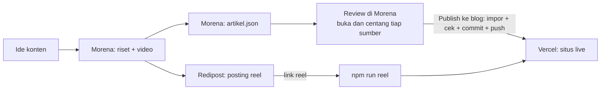
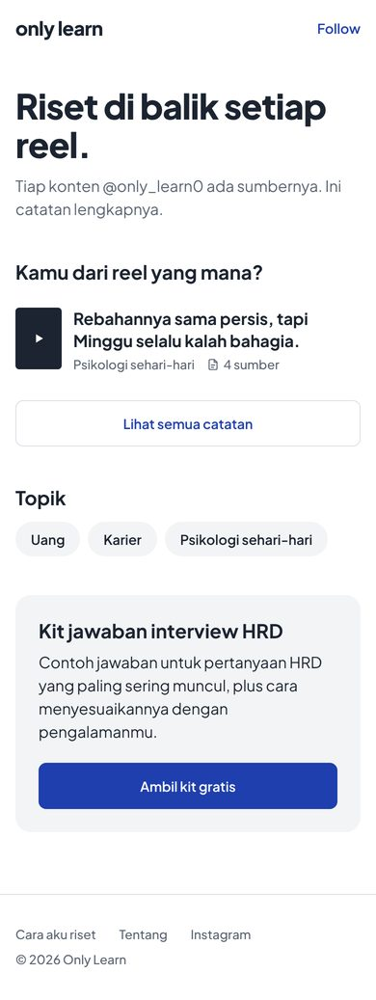
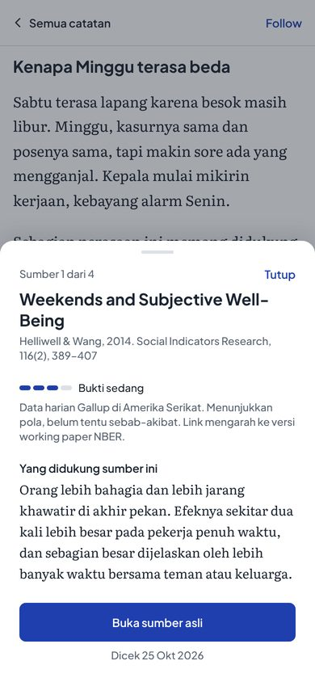
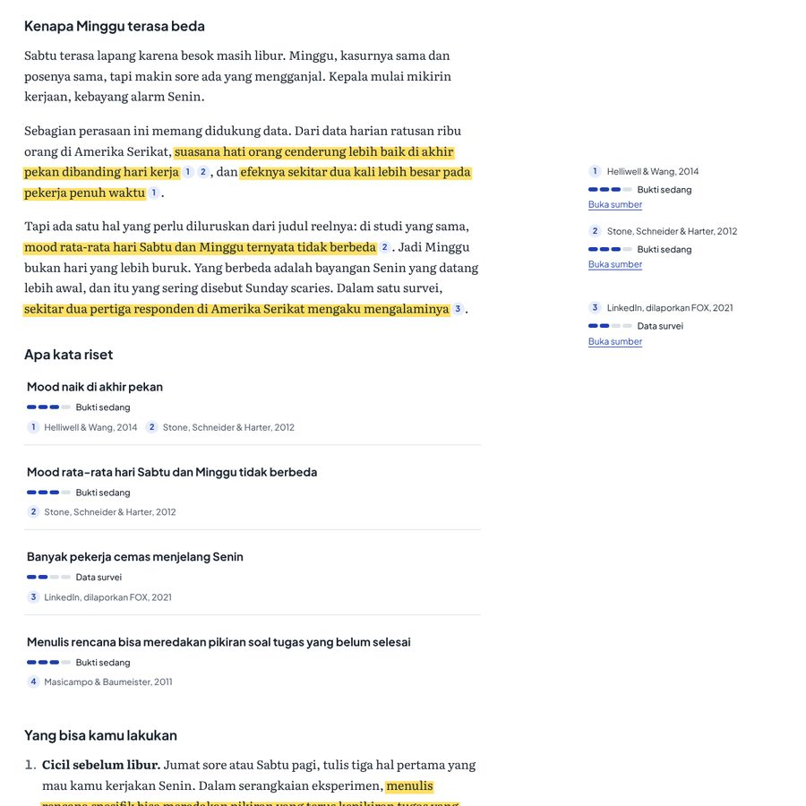

# Only Learn

Catatan riset di balik setiap reel [@only_learn0](https://www.instagram.com/only_learn0/). Setiap klaim di artikel ditandai stabilo kuning dan diberi nomor sumber, lengkap dengan level buktinya. Tujuannya satu: membuktikan bahwa konten Only Learn memang ada risetnya.

Versi dokumen 1.0, 25 Oktober 2026.

---

## Mulai cepat

Butuh Node.js 20.9 atau lebih baru.

```bash
npm install
cp .env.example .env.local
npm run dev
```

Buka http://localhost:3000. Di mode dev, catatan berstatus draft ikut tampil dengan label "Draft".

## Alur kerja dalam satu gambar



Satu riset menghasilkan tiga output: video (Remotion), caption dan posting (Redipost), dan catatan di blog ini. Detailnya ada di [docs/03-integrasi-morena-redipost.md](docs/03-integrasi-morena-redipost.md).

## Perintah

| Perintah | Fungsi |
|---|---|
| `npm run dev` | Jalankan situs lokal (draft ikut tampil) |
| `npm run baru -- "Hook reel" --topik uang` | Buat catatan baru dari template (draft) |
| `npm run impor -- file.json` | Dijalankan Morena saat **Publish ke blog** (lihat [docs/03](docs/03-integrasi-morena-redipost.md)). Manual: impor artikel.json jadi catatan draft |
| `npm run reel -- <slug> <link-reel>` | Isi link reel setelah terbit di Instagram |
| `npm run cek` | Validasi semua catatan. Otomatis jalan sebelum build |
| `npm run build` | Cek konten lalu build produksi |
| `npm run tokens` | Generate ulang token Tailwind dari DESIGN.md |
| `npm run schema` | Ekspor JSON Schema research-note untuk Morena |
| `npm run typecheck` | Cek TypeScript |

## Struktur folder

```
only-learn/
├── content/
│   ├── catatan/          ← satu file .mdx = satu catatan = satu reel
│   └── halaman/          ← halaman bebas (Tentang)
├── templates/catatan.mdx ← template untuk `npm run baru`
├── examples/             ← contoh research-note.json dari Morena
├── schemas/              ← JSON Schema hasil `npm run schema`
├── public/reels/         ← poster/thumbnail reel (jpg)
├── scripts/              ← CLI: baru, cek, impor, reel, schema
├── src/
│   ├── app/              ← halaman Next.js (App Router)
│   ├── components/       ← Klaim, sheet sumber, meteran bukti, dll.
│   ├── lib/              ← schema, loader konten, level bukti, konfigurasi situs
│   └── styles/tokens.css ← hasil generate dari DESIGN.md (jangan edit manual)
├── DESIGN.md             ← sumber kebenaran desain (format Stitch)
├── design/stitch-prompts.md
└── docs/                 ← panduan lengkap
```

## Dokumentasi

1. [Menulis dan update catatan](docs/01-menulis-dan-update-catatan.md): panduan harian.
2. [Referensi frontmatter](docs/02-referensi-frontmatter.md): semua field dan aturannya.
3. [Integrasi Morena dan Redipost](docs/03-integrasi-morena-redipost.md): kontrak data dan otomasi.
4. [Deploy](docs/04-deploy.md): Vercel, domain, preview draft.
5. [Desain dan token](docs/05-desain-dan-token.md): DESIGN.md, token, dan cara memakai hasil Stitch.

## Kenapa dibangun seperti ini

- **Konten di Git, bukan CMS atau database.** Setiap perubahan dan koreksi tercatat di riwayat commit. Untuk situs yang menjual legitimasi, jejak perubahan ini adalah bukti. Tidak ada server atau database yang perlu dirawat.
- **Validasi ketat sebelum build.** `npm run cek` memastikan setiap stabilo menunjuk ke sumber yang ada dan catatan yang sudah terbit tidak menyisakan teks template. Catatan yang rusak tidak bisa ter-deploy.
- **Statis penuh.** Semua halaman di-render saat build, sehingga terbuka cepat dari link bio Instagram walaupun sinyal lemah.
- **Desain satu sumber.** Warna, font, dan ukuran berasal dari `DESIGN.md`, file yang sama yang dipakai Stitch. Kalau desain berubah, cukup jalankan `npm run tokens`.

## Tech stack

Next.js 16 (App Router, SSG), React 19, MDX lewat `@mdx-js/mdx`, Zod 4 untuk schema, Tailwind CSS 4, font self-hosted lewat Fontsource (Plus Jakarta Sans dan Literata), TypeScript.

## Tampilan

| Beranda (mobile) | Sheet sumber (mobile) |
|---|---|
|  |  |

Artikel di desktop, dengan stabilo, nomor footnote, dan sidenote di margin kanan:


