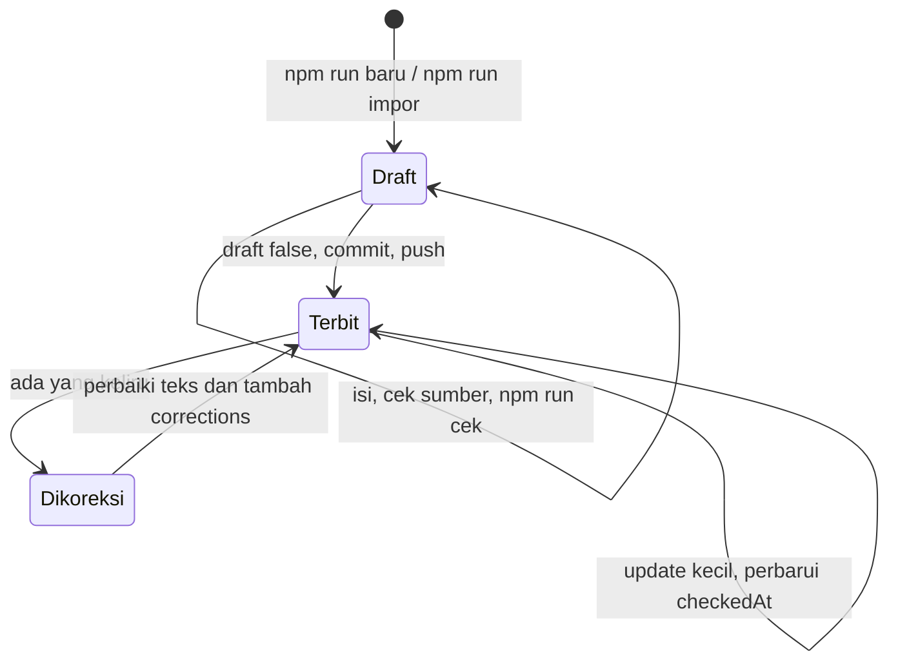
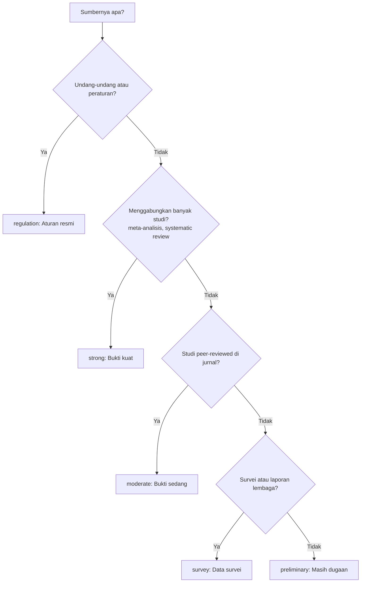

# Menulis dan update catatan

Panduan harian. Satu catatan = satu reel = satu file di `content/catatan/<slug>.mdx`.

---

## 1. Siklus hidup catatan



- **Draft** hanya tampil di `npm run dev` dan di Preview Vercel. Tidak muncul di situs produksi, sitemap, maupun Google.
- **Terbit** berarti `draft: false` dan sudah di-push.
- **Dikoreksi** berarti isinya diperbaiki, dan koreksinya dicatat terbuka. Jangan pernah menghapus kesalahan diam-diam, karena keterbukaan koreksi adalah bagian dari legitimasi.

---

## 2. Membuat catatan baru

**Cara A: dari Morena** (disarankan kalau risetnya sudah dikerjakan Morena)

Tidak ada perintah yang perlu dijalankan di repo ini. Di Morena, tekan **Buat artikel** pada video yang sudah selesai, buka dan centang setiap sumber di halaman review, lalu tekan **Publish ke blog**. Morena yang mengimpor, menjalankan `npm run cek`, commit, dan push. Detailnya di [03-integrasi-morena-redipost.md](03-integrasi-morena-redipost.md).

**Cara B: manual dari template**

```bash
npm run baru -- "Unpopular opinion: pria paling aman itu yang keliatan bokek." --topik uang --slug keliatan-bokek
```

Topik yang tersedia: `uang`, `karier`, `psikologi-sehari-hari` (diatur di `src/lib/site.ts`).

Slug adalah nama file sekaligus URL (`/catatan/keliatan-bokek`). Buat pendek dan mudah dibaca.

---

## 3. Anatomi file

```mdx
---
title: "Unpopular opinion: pria paling aman itu yang keliatan bokek."   ← hook reel, apa adanya
description: "Satu kalimat untuk Google dan preview link (maks 200 karakter)."
topic: uang
publishedAt: 2026-10-24       ← tanggal terbit
checkedAt: 2026-10-24         ← tanggal terakhir semua sumber dicek
draft: true
reel:
  url: https://www.instagram.com/reel/De3-ajlCIXL/
  poster: /reels/keliatan-bokek.jpg
summary:                      ← 1–5 poin untuk bagian "Ringkasan"
  - ...
sources:                      ← daftar sumber, urutannya = nomor footnote
  - id: stanley-danko-1996
    title: The Millionaire Next Door
    authors: Stanley & Danko
    year: 1996
    publisher: Longstreet Press
    url: https://...
    level: moderate
    supports: Satu kalimat tentang apa yang didukung sumber ini.
    note: (opsional) jenis studi, jumlah responden, batasannya.
claims:                       ← isi bagian "Apa kata riset"
  - text: Banyak orang kaya hidup sederhana
    sources: [stanley-danko-1996]
---

## Kenapa pamer itu berisiko

Teks biasa. Kalimat yang didukung riset ditandai:
<Klaim sumber="stanley-danko-1996">banyak orang kaya di Amerika justru hidup sederhana</Klaim>.

<ApaKataRiset />

## Yang bisa kamu lakukan

1. **Langkah pertama.** Penjelasan.
```

Referensi lengkap setiap field ada di [02-referensi-frontmatter.md](02-referensi-frontmatter.md).

---

## 4. Menandai klaim dengan `<Klaim>`

```mdx
<Klaim sumber="stone-2012">mood rata-rata Sabtu dan Minggu tidak berbeda</Klaim>
<Klaim sumber="helliwell-wang-2014,stone-2012">mood lebih baik di akhir pekan</Klaim>
```

Hasilnya: kalimat distabilo kuning, diikuti nomor footnote. Di HP, nomor bisa diketuk untuk membuka sheet sumber. Di desktop, sumber muncul di margin kanan.

**Aturan stabilo:**

| Stabilo | Jangan distabilo |
|---|---|
| Fakta yang datang dari sumber (angka, hasil studi, isi aturan) | Opini, saran, atau metafora kamu sendiri |
| Kalimat pendek, cukup bagian yang benar-benar didukung | Satu paragraf penuh |
| Kalimat yang sesuai dengan isi sumber | Klaim yang lebih kuat dari isi sumbernya |

Uji sederhananya: kalau seseorang membuka sumbernya, apakah dia akan menemukan hal yang sama? Kalau ragu, perlemah kalimatnya ("cenderung", "dalam satu survei") atau turunkan level buktinya.

---

## 5. Memilih level bukti



Catatan:
- Buku populer yang berbasis riset penulisnya (misalnya *The Millionaire Next Door*) masuk `moderate` kalau datanya jelas. Kalau isinya lebih banyak opini, pakai `preliminary`.
- Berita yang melaporkan survei tetap `survey`. Kalau laporan aslinya ada, pakai link laporan asli.
- Level di bagian "Apa kata riset" otomatis memakai level **terkuat** dari sumber-sumber klaim itu.

---

## 6. Preview dan cek

```bash
npm run dev     # buka http://localhost:3000/catatan/<slug>
npm run cek     # validasi semua catatan
```

`npm run cek` menangkap masalah seperti:

| Pesan | Artinya |
|---|---|
| `<Klaim sumber="x"> menunjuk sumber yang tidak ada` | ID di teks tidak cocok dengan `sources` (biasanya salah ketik) |
| `Sumber "x" tidak pernah dikutip` | Ada sumber yang tidak dipakai. Hapus, atau tandai klaimnya |
| `Masih ada teks GANTI_INI` | Bagian template belum diisi. Ini error kalau `draft: false` |
| `reel.url belum diisi` | Isi lewat `npm run reel`. Ini error kalau `draft: false` |
| `Poster ... belum ada` | File thumbnail belum ditaruh di `public/reels/`. Situs tetap jalan dengan placeholder |
| `Format tanggal harus YYYY-MM-DD` | Tulis tanggal seperti `2026-10-25` |

---

## 7. Menerbitkan

1. Buka **setiap** link sumber dan pastikan isinya mendukung kalimat yang distabilo. Ini langkah yang tidak boleh diotomasi.
2. Ubah `draft: true` menjadi `draft: false`.
3. Commit dan push:
   ```bash
   git add content/catatan/keliatan-bokek.mdx public/reels/keliatan-bokek.jpg
   git commit -m "catatan: keliatan bokek"
   git push
   ```
4. Vercel otomatis build dan deploy. Kalau `npm run cek` gagal, deploy dibatalkan dan situs lama tetap jalan.

---

## 8. Update catatan yang sudah terbit

| Situasi | Yang dilakukan |
|---|---|
| Sumber dicek ulang, isinya tetap | Perbarui `checkedAt` |
| Tambah sumber atau penjelasan baru | Edit, lalu perbarui `checkedAt` |
| Ada yang keliru (angka salah, klaim berlebihan) | Perbaiki teks, perbarui `checkedAt`, **dan** tambah entri di `corrections` |
| Link sumber mati | Ganti dengan arsip (misalnya web.archive.org) atau sumber lain yang setara, lalu perbarui `checkedAt` |

Contoh koreksi:

```yaml
corrections:
  - date: 2026-11-02
    text: Angka survei diganti dari 80% ke 66% sesuai laporan aslinya.
```

Koreksi tampil di bawah artikel dengan warna merah, dan otomatis terkumpul di halaman `/cara-aku-riset#koreksi`.

---

## 9. Poster reel

1. Ekspor satu frame dari video (di Remotion bisa lewat `npx remotion still`), format portrait, misalnya 540×960, jpg di bawah 150 KB.
2. Simpan di `public/reels/<slug>.jpg`.
3. Pasang:
   ```bash
   npm run reel -- keliatan-bokek https://www.instagram.com/reel/De3-ajlCIXL/ --poster /reels/keliatan-bokek.jpg
   ```

Tanpa poster pun situs tetap jalan: thumbnail diganti blok gelap dengan ikon play.

---

## 10. Mengubah teks situs

| Yang mau diubah | File |
|---|---|
| Tagline, intro, handle Instagram, lead magnet | `src/lib/site.ts` |
| Daftar topik dan deskripsinya | `src/lib/site.ts` (topik baru otomatis punya halaman `/topik/<slug>`) |
| Label dan penjelasan level bukti | `src/lib/evidence.ts` |
| Halaman Tentang | `content/halaman/tentang.mdx` |
| Empat langkah di "Cara aku riset" | `src/app/cara-aku-riset/page.tsx` |
