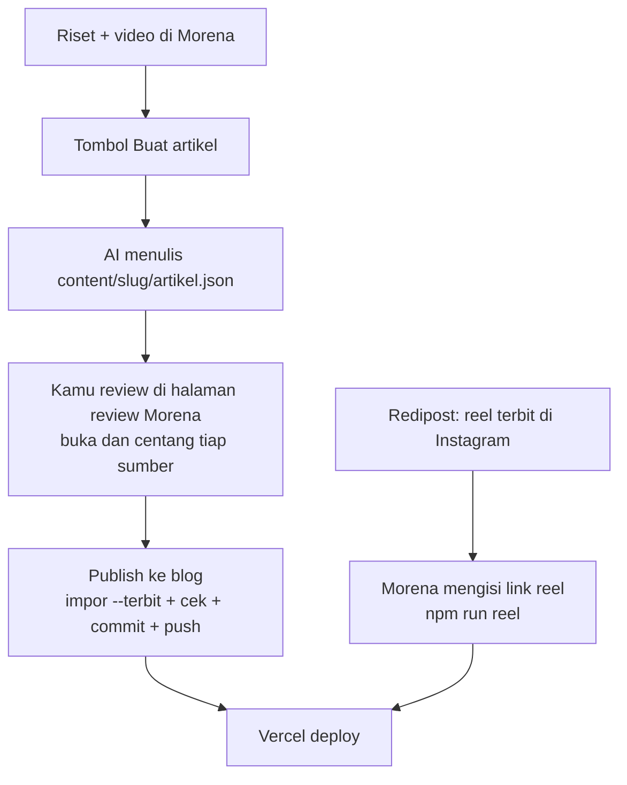

# Integrasi Morena dan Redipost

Morena sudah meriset dan membuat video. Riset yang sama langsung jadi artikel di blog, jadi video dan artikel tidak pernah berbeda.



**Kenapa ini penting:** kalau video dan artikel berasal dari riset yang sama, angka di reel dan di blog tidak akan pernah berbeda. Itu dasar legitimasinya.

---

## 1. Kontrak data: research-note

Morena menghasilkan satu file JSON per konten dan menyimpannya di `content/<slug>/artikel.json`. Kontraknya disebut research-note. Schema lengkapnya ada di `schemas/research-note.schema.json` (regenerate dengan `npm run schema`), dan contohnya di `examples/research-note.example.json`.

```json
{
  "slug": "sunday-scaries",
  "topic": "psikologi-sehari-hari",
  "hook": "Rebahannya sama persis, tapi Minggu selalu kalah bahagia.",
  "description": "Maks 200 karakter, untuk Google dan preview link.",
  "summary": ["Poin 1", "Poin 2", "Poin 3"],
  "body": "## Kenapa Minggu terasa beda\n\n... <Klaim sumber=\"stone-2012\">kalimat</Klaim> ...\n\n<ApaKataRiset />\n\n## Yang bisa kamu lakukan\n\n1. ...",
  "sources": [
    {
      "id": "stone-2012",
      "title": "Judul asli",
      "authors": "Stone, Schneider & Harter",
      "year": 2012,
      "publisher": "The Journal of Positive Psychology, 7(4)",
      "url": "https://doi.org/10.1080/17439760.2012.691980",
      "level": "moderate",
      "supports": "Apa yang didukung sumber ini, satu kalimat.",
      "note": "Opsional: jenis studi, jumlah responden."
    }
  ],
  "claims": [{ "text": "Mood naik di akhir pekan", "sources": ["stone-2012"] }],
  "reel": { "poster": "/reels/sunday-scaries.jpg" },
  "thumbnail": "/thumbs/sunday-scaries.jpg",
  "checkedAt": "2026-10-25"
}
```

Field yang dipakai blog sama dengan frontmatter (lihat [02-referensi-frontmatter.md](02-referensi-frontmatter.md)), dengan dua perbedaan: `hook` jadi `title`, dan isi artikel dikirim di `body`.

Kalau Morena butuh field tambahan untuk dirinya sendiri (naskah video, storyboard, caption), simpan di file terpisah atau di field lain. Importer hanya membaca field di atas, dan schema menolak field yang salah tipe.

---

## 2. Alur: dari video ke artikel

1. Setelah video selesai dirender, Morena menampilkan tombol **Buat artikel**. AI menulis `content/<slug>/artikel.json` sesuai kontrak di atas.
2. Kamu review di halaman review Morena. Buka setiap link sumber dan centang satu per satu, pastikan kalimat yang distabilo memang didukung isinya.
3. Tombol **Publish ke blog** baru aktif kalau semua sumber sudah dicentang. Morena lalu menjalankan, dari folder blog:
   ```bash
   npm run --silent impor -- <path absolut artikel.json> --cek      # validasi dulu, exit 1 kalau ada error
   npm run --silent impor -- <path absolut artikel.json> --terbit   # tambah --timpa (dan --koreksi "<teks>") kalau terbit ulang
   npm run cek
   ```
   Lalu commit hanya `content/catatan/<slug>.mdx`, `public/reels/<slug>.jpg`, dan `public/thumbs/<slug>.jpg` (kalau ada thumbnail), dan push. Vercel yang deploy.
4. `--timpa` mempertahankan `publishedAt` dan koreksi lama. `--koreksi` menambah satu catatan koreksi bertanggal hari ini, dan hanya bisa dipakai untuk artikel yang sudah ada.

**Kenapa gerbang centang sumber ada:** AI bisa salah mengutip, menebak DOI, atau membuat klaim yang lebih kuat dari isi sumbernya. Blog ini menjual kepercayaan, jadi satu sumber yang salah merusak semua catatan lain. Langkah cek manual adalah satu-satunya bagian yang tidak boleh diotomasi.

---

## 2b. Thumbnail artikel

Kartu artikel di beranda memakai gambar 16:9. Blog hanya mendukungnya; gambarnya dibuat Morena.

- **Field:** `thumbnail: "/thumbs/<slug>.jpg"` di `artikel.json` (opsional). Nilainya harus path lokal berawalan `/thumbs/`, huruf kecil, angka, tanda hubung, berakhiran `.jpg`, `.jpeg`, `.webp`, atau `.png`. URL luar dan `..` ditolak schema.
- **Format yang disarankan:** 1200x675 (16:9), JPEG atau WebP, maksimal 200 KB.
- **Tugas Morena:**
  1. menyalin gambar ke `public/thumbs/<slug>.jpg` di folder blog;
  2. mengisi `thumbnail` di `artikel.json`;
  3. ikut meng-commit file gambar itu saat publish.
- **Importer** meneruskan field ini ke frontmatter. `npm run cek` memberi warning (bukan error) kalau file lokalnya tidak ada.
- **Urutan pakai di kartu:** thumbnail, lalu poster reel, lalu kotak gradasi pastel dengan monogram OL.

---

## 3. Link reel (opsional, diisi belakangan)

Artikel boleh terbit tanpa `reel.url`; `cek` hanya memberi warning. Setelah Redipost melaporkan reel Instagram sudah terbit, Morena mengisinya dengan:

```bash
npm run reel -- <slug> <link-reel>
```

lalu commit dan push lagi. Tidak ada link ke blog di caption Instagram.

---

## 4. Instruksi untuk AI riset di Morena

Tempel blok ini ke prompt langkah riset di Morena supaya output-nya langsung cocok dengan blog:

```text
Selain naskah video, tulis content/<slug>/artikel.json mengikuti schema research-note Only Learn.

Aturan sumber:
- Utamakan sumber primer: artikel jurnal (pakai link DOI), laporan resmi lembaga, atau peraturan resmi. Hindari artikel yang hanya mengutip ulang.
- Jangan pernah mengarang sumber, DOI, angka, atau tahun. Kalau tidak menemukan sumber, tulis klaimnya sebagai opini dan jangan ditandai <Klaim>.
- Isi "supports" dengan apa yang benar-benar dikatakan sumber, bukan apa yang ingin dibuktikan naskah.
- Pilih level: strong (meta-analisis atau tinjauan sistematis), moderate (satu studi peer-reviewed), survey (survei atau laporan), preliminary (hipotesis atau opini ahli), regulation (UU atau peraturan).
- Kalau hook reel lebih kuat dari isi riset, tulis koreksinya secara terbuka di body.

Aturan body (MDX, Bahasa Indonesia, sapaan "kamu"):
- Mulai dengan "## <judul penjelasan>", lalu 2–3 paragraf penjelasan.
- Tandai hanya kalimat faktual dari sumber: <Klaim sumber="id-sumber">kalimat</Klaim>. Beberapa sumber dipisah koma.
- Letakkan <ApaKataRiset /> setelah penjelasan.
- Tutup dengan "## Yang bisa kamu lakukan" berisi 2–4 langkah bernomor.
```

Contoh nyata kenapa aturan "hook lebih kuat dari riset" penting ada di catatan `sunday-scaries`: studi besar menemukan mood Sabtu dan Minggu ternyata **tidak** berbeda, jadi artikelnya meluruskan hook reel secara terbuka.
