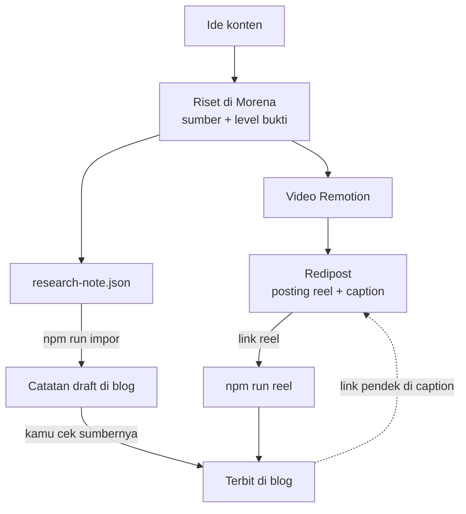
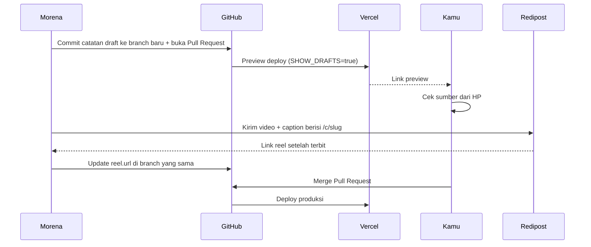

# Integrasi Morena dan Redipost

Morena sudah meriset, membuat video, lalu mengirimnya ke Redipost. Riset yang sama bisa langsung jadi catatan di blog. Satu riset, tiga output.



**Kenapa ini penting:** kalau video dan artikel berasal dari riset yang sama, angka di reel dan di blog tidak akan pernah berbeda. Itu dasar legitimasinya.

---

## 1. Kontrak data: `research-note.json`

Morena cukup menghasilkan satu file JSON per konten. Schema lengkapnya ada di `schemas/research-note.schema.json` (regenerate dengan `npm run schema`), dan contohnya di `examples/research-note.example.json`.

```json
{
  "slug": "sunday-scaries",
  "topic": "psikologi-sehari-hari",
  "hook": "Rebahannya sama persis, tapi Minggu selalu kalah bahagia.",
  "description": "Maks 200 karakter, untuk Google dan preview link.",
  "summary": ["Poin 1", "Poin 2", "Poin 3"],
  "body": "## Kenapa Minggu terasa beda\n\n... <Klaim sumber=\"stone-2012\">kalimat</Klaim> ...\n\n<ApaKataRiset />\n\n## Yang bisa kamu lakukan\n\n1. ...",
  "sources": [
    {
      "id": "stone-2012",
      "title": "Judul asli",
      "authors": "Stone, Schneider & Harter",
      "year": 2012,
      "publisher": "The Journal of Positive Psychology, 7(4)",
      "url": "https://doi.org/10.1080/17439760.2012.691980",
      "level": "moderate",
      "supports": "Apa yang didukung sumber ini, satu kalimat.",
      "note": "Opsional: jenis studi, jumlah responden."
    }
  ],
  "claims": [{ "text": "Mood naik di akhir pekan", "sources": ["stone-2012"] }],
  "reel": { "poster": "/reels/sunday-scaries.jpg" },
  "checkedAt": "2026-10-25"
}
```

Field yang dipakai blog sama dengan frontmatter (lihat [02-referensi-frontmatter.md](02-referensi-frontmatter.md)), dengan dua perbedaan: `hook` jadi `title`, dan isi artikel dikirim di `body`.

Kalau Morena butuh field tambahan untuk dirinya sendiri (naskah video, storyboard, caption), simpan di file terpisah atau di field lain. Importer hanya membaca field di atas, dan schema menolak field yang salah tipe.

---

## 2. Tahap 1: semi-otomatis (disarankan untuk sekarang)

1. Morena menyimpan `research-note.json` di folder output-nya.
2. Di repo blog:
   ```bash
   npm run impor -- ~/morena/output/sunday-scaries.research-note.json
   ```
   Hasilnya selalu **draft**, dan validasi langsung jalan.
3. Buka setiap link sumber. Pastikan kalimat yang distabilo memang didukung isinya.
4. Setelah Redipost memposting reel:
   ```bash
   npm run reel -- sunday-scaries https://www.instagram.com/reel/De5eo3WFZqJ/ --poster /reels/sunday-scaries.jpg
   ```
5. Ubah `draft: false`, commit, push.

**Kenapa hasil impor selalu draft:** AI bisa salah mengutip, menebak DOI, atau membuat klaim yang lebih kuat dari isi sumbernya. Blog ini menjual kepercayaan, jadi satu sumber yang salah merusak semua catatan lain. Langkah cek manual adalah satu-satunya bagian yang tidak boleh diotomasi.

---

## 3. Tahap 2: otomatis penuh (nanti, kalau tahap 1 sudah rutin)



Yang perlu dibangun di sisi Morena:
- Menjalankan logika yang sama dengan `scripts/impor.ts` (atau memanggil repo ini), lalu commit lewat GitHub API ke branch `catatan/<slug>` dan membuka Pull Request.
- Setelah Redipost mendapat permalink reel dari Instagram, perbarui `reel.url` di branch itu.
- Di Vercel, aktifkan `SHOW_DRAFTS=true` **hanya** untuk environment Preview (lihat [04-deploy.md](04-deploy.md)).

Gerbang review tetap ada: Pull Request baru masuk produksi setelah kamu merge.

---

## 4. Caption otomatis

Karena Morena tahu `slug`-nya sejak awal, tambahkan baris ini di akhir caption yang dikirim ke Redipost:

```
Sumber lengkapnya: onlylearn.id/c/{slug} (link di bio)
```

Link di caption Instagram tidak bisa diklik, jadi buat link-nya pendek dan mudah diketik. Pastikan link bio mengarah ke beranda blog, karena beranda menampilkan catatan terbaru di urutan teratas.

---

## 5. Instruksi untuk AI riset di Morena

Tempel blok ini ke prompt langkah riset di Morena supaya output-nya langsung cocok dengan blog:

```text
Selain naskah video, hasilkan research-note.json sesuai schema Only Learn.

Aturan sumber:
- Utamakan sumber primer: artikel jurnal (pakai link DOI), laporan resmi lembaga, atau peraturan resmi. Hindari artikel yang hanya mengutip ulang.
- Jangan pernah mengarang sumber, DOI, angka, atau tahun. Kalau tidak menemukan sumber, tulis klaimnya sebagai opini dan jangan ditandai <Klaim>.
- Isi "supports" dengan apa yang benar-benar dikatakan sumber, bukan apa yang ingin dibuktikan naskah.
- Pilih level: strong (meta-analisis atau tinjauan sistematis), moderate (satu studi peer-reviewed), survey (survei atau laporan), preliminary (hipotesis atau opini ahli), regulation (UU atau peraturan).
- Kalau hook reel lebih kuat dari isi riset, tulis koreksinya secara terbuka di body.

Aturan body (MDX, Bahasa Indonesia, sapaan "kamu"):
- Mulai dengan "## <judul penjelasan>", lalu 2–3 paragraf penjelasan.
- Tandai hanya kalimat faktual dari sumber: <Klaim sumber="id-sumber">kalimat</Klaim>. Beberapa sumber dipisah koma.
- Letakkan <ApaKataRiset /> setelah penjelasan.
- Tutup dengan "## Yang bisa kamu lakukan" berisi 2–4 langkah bernomor.
```

Contoh nyata kenapa aturan "hook lebih kuat dari riset" penting ada di catatan `sunday-scaries`: studi besar menemukan mood Sabtu dan Minggu ternyata **tidak** berbeda, jadi artikelnya meluruskan hook reel secara terbuka.

---

## 6. Yang perlu disesuaikan

Dokumen ini disusun tanpa melihat kode Morena dan API Redipost secara langsung. Yang perlu dicocokkan:
- Format output riset Morena sekarang, untuk dipetakan ke `research-note.json`.
- Apakah Redipost menyimpan permalink reel setelah publish. Ini dibutuhkan untuk mengisi `reel.url` otomatis di tahap 2.
- Lokasi folder output Morena, untuk perintah `npm run impor`.
