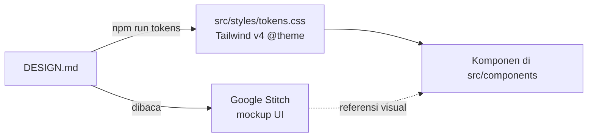

# Desain dan token

## Satu sumber kebenaran

`DESIGN.md` di root repo adalah file yang sama dengan yang dipakai Stitch. Kalau warna, font, atau ukuran berubah:

1. Edit `DESIGN.md`.
2. Jalankan `npm run tokens`. Perintah ini menjalankan lint resmi DESIGN.md (termasuk cek kontras WCAG), lalu menulis ulang `src/styles/tokens.css`.
3. Commit kedua file.

Jangan edit `tokens.css` secara manual, karena perubahannya akan tertimpa.

## Yang tidak bisa diekspresikan di DESIGN.md

Ada di `src/app/globals.css`:
- **Stack font:** nama font self-hosted dari Fontsource ("Plus Jakarta Sans Variable", "Literata Variable") beserta fallback-nya.
- **Line-height, letter-spacing, dan bobot per ukuran teks.** Di Tailwind v4, class `font-display` hanya mengatur font-family, jadi bobot (800, 700, dan seterusnya) dipasang lewat `--text-*--font-weight`. Dengan begitu `text-display` sudah lengkap: ukuran, tinggi baris, dan bobot.
- **Stabilo** (`mark.klaim`), nomor footnote (`.fn`), sidenote desktop (`.sidenote`), dan sheet sumber (`dialog.sheet`).

## Peta komponen

| Komponen di DESIGN.md | File |
|---|---|
| top-bar | `src/components/top-bar.tsx` |
| reel-row | `src/components/reel-row.tsx` |
| claim-highlight, footnote-marker | `src/components/research.tsx` (`Klaim`) + `globals.css` |
| source-sheet | `src/components/source-dialog.tsx` |
| sidenote (desktop) | `src/components/research.tsx` + `.sidenote` di `globals.css` |
| evidence-meter | `src/components/evidence-meter.tsx` |
| source-card / daftar sumber | `src/components/research.tsx` (`SourceList`) |
| correction-note | `src/components/research.tsx` (`CorrectionNote`) |
| topic-chip | chip topik di `src/components/jelajah.tsx` (`DaftarJelajah`: tombol saring di beranda, tautan di `/catatan` dan `/topik/<slug>`) dan pil topik di `top-bar.tsx` |
| button-primary, button-secondary | `src/components/ui.tsx` (`ButtonLink`) |
| pita halaman pastel (`PitaHalaman`) dan hero beranda (`HeroBeranda`) | `src/components/hero.tsx` |
| kartu artikel | `src/components/kartu-artikel.tsx` |
| warna tag topik (`topics[].warna`, `kelasTag`) | `src/lib/site.ts`, dipakai kartu artikel, pita artikel, dan Kategori Populer |
| tombol Simpan, halaman Tersimpan | `src/components/simpan.tsx`, `src/app/tersimpan` |
| Jelajah (cari + filter), Kategori Populer, langganan | `src/components/jelajah.tsx`, `kategori-populer.tsx`, sidebar |
| footer | `src/components/footer.tsx` |
| Wordmark (logo + "Only Learn") | `src/components/ui.tsx` (`Wordmark`) |
| tautan reel (thumbnail + play) | `src/components/reel-link.tsx` (`ReelLink`) |

## Memakai hasil Stitch

Stitch menghasilkan HTML dan Tailwind dengan nama class miliknya sendiri. Jangan tempel mentah-mentah ke repo. Pakai hasilnya sebagai **referensi visual**:

1. Bandingkan screenshot Stitch dengan halaman lokal (`npm run dev`).
2. Kalau ada yang lebih baik di Stitch (jarak, ukuran, susunan), ubah komponen yang sesuai di tabel di atas dengan token yang sudah ada (`text-title`, `bg-surface`, `rounded-lg`, dan seterusnya).
3. Kalau Stitch memakai warna atau ukuran yang tidak ada di token, putuskan dulu: tambahkan ke `DESIGN.md` (lalu `npm run tokens`), atau ikuti token yang ada.

Cara ini menjaga desain tetap konsisten, dan perubahan desain selalu lewat satu pintu.

## Aturan visual yang dijaga di kode

- Kuning hanya dipakai di `mark.klaim`. Tidak ada komponen lain yang memakai `bg-highlight`.
- Merah hanya dipakai di `CorrectionNote`.
- Meteran bukti selalu disertai label teks (dan teks untuk pembaca layar), tidak hanya warna.
- Tidak ada animasi kecuali sheet sumber, dan itu pun mati kalau pengguna memilih `prefers-reduced-motion`.
- Judul memakai `text-navy`, aksi dan tautan memakai `text-primary` (biru). Teal sudah tidak dipakai.
- Gradasi pastel dan gelombang hanya ada di `PitaHalaman`/`HeroBeranda` (token `hero-*`) dan kotak pengganti poster.
- Bayangan navy yang lembut (`rgba(19,27,58,…)`) hanya ada di kartu artikel (lebih dalam saat hover), kotak cari, kartu Kategori Populer, kartu langganan, dan sheet sumber. Kartu putih juga memakai `border-line`.
- Tag topik memakai pasangan `tag-*-bg`/`tag-*-fg`; meteran bukti memakai `meter-filled`/`meter-empty`.
